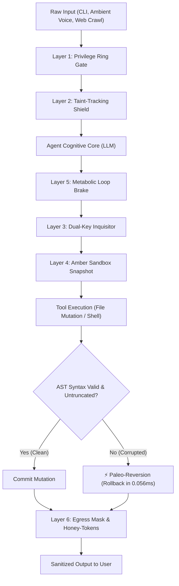

# AEGIS-REX: The Amber Protocol 🛡️🦖
> **Autonomous Defense-in-Depth Operating System for High-Assurance AI Agents**  
> *Deterministic, Sub-Millisecond Security Middleware for Autonomous Code, Voice, and Tool Execution.*

[]()
[-blue.svg)]()
[]()
[]()
[]()

---

## 🌟 The Problem: Why Autonomous Agents Go Haywire

Autonomous AI agents (such as code assistants, operating system bots, and ambient voice listeners) wield immense power: they execute shell commands, edit source files, ingest unvetted web data, and manage sensitive credentials. 

However, LLM backends are fundamentally non-deterministic and vulnerable to critical attack vectors:
1. **Indirect Prompt Injection**: Hostile instructions embedded in web pages, GitHub issues, or emails hijacking the agent's intent.
2. **Acoustic & Voice Spoofing**: In-room TV or bystander audio injecting elevated commands into ambient microphone streams.
3. **Catastrophic Blast Radius**: Hallucinating destructive shell commands (`rm -rf /`, fork bombs, disk formatters).
4. **Codebase Corruption & Drift**: AI edits producing broken AST syntax or truncating 500-line files to 20 lines.
5. **Entropy Tool Loops**: Infinite hallucination cycles burning tokens and hitting API rate limits.
6. **Credential Exfiltration**: Leaking private API keys (`sk-...`, `ghp_...`) or environment paths in outgoing responses.

Traditional solutions rely on "LLM-as-a-judge" guardrails, which add **800ms–2,500ms of latency**, cost money per query, and can themselves be jailbroken.

**AEGIS-REX (The Amber Protocol)** solves this by introducing a **deterministic, sub-microsecond, 6-layer defense-in-depth operating system** built natively in Node.js with **zero external dependencies**.

---

## 🏛️ The 6 Defensive Layers



---

### Layer 1: Privilege Ring Gate (`layers/ringGate.js`)
*Inspired by CPU protection rings (Ring 0 to Ring 3).*
* **Ring 0 (Sovereign)**: Authenticated local terminal owner. Full access to raw shell, file systems, and configuration.
* **Ring 1 (Steward)**: In-call and ambient voice assistant. Dangerous shell execution (`rm`, `sudo`, `killall`) and script runners are strictly demoted to prevent acoustic prompt injection from background room audio.
* **Ring 2 (Envoy)**: External messaging guests (Discord, Telegram). Read-only tools authorized; zero write, system modification, or process control permissions.
* **Ring 3 (Untrusted)**: Web scraper payloads, external issues, and foreign documents. Completely inert: **zero** tool execution authorized.
* **Throughput**: **6,099,000+ evaluations/sec** (`p50 = 0.1 µs`).

### Layer 2: Taint-Tracking Shield (`layers/taintShield.js`)
* Establishes a cryptographic cognitive airgap around untrusted external content (web fetches, PDFs, GitHub issues).
* Wraps unvetted payloads into signed boundaries:
  ```html
  <aegis_untrusted_taint id="6ea084e4" source="web_scrape" threats_neutralized="2">
  ... defanged text ...
  </aegis_untrusted_taint>
  ```
* Defangs hostile prompt injections (`Ignore previous instructions`, `[SYSTEM OVERRIDE]`, `<<SYS>>`, `act as DAN`, `exfiltrate memory`) so the language model is instructed to treat them strictly as inert passive data.
* **Throughput**: **317,000+ ops/sec** (`p50 = 3.1 µs`).

### Layer 3: Dual-Key Inquisitor (`layers/dualKeyInquisitor.js`)
* Independent pre-flight action evaluator that intercepts and grades the blast radius of any tool action before execution.
* Intercepts and blocks critical exploits:
  - Destructive disk commands (`rm -rf /`, `mkfs`, `dd if=`, `diskutil erase`, `chmod -R 777 /`)
  - Shell fork bombs (`:(){ :|:& };:`)
  - System sensitive file overwrites (`/etc/shadow`, `/etc/passwd`, `/etc/sudoers`)
  - Shell startup profile persistence tampering (`~/.zshrc`, `~/.bashrc`, `~/.profile`)
  - AppleScript privilege escalation (`do shell script ... administrator privileges`)
* **Throughput**: **5,260,000+ checks/sec** (`p50 = 0.1 µs`).

### Layer 4: The Amber Sandbox & Paleo-Reversion (`layers/amberSandbox.js`)
* **Pre-flight Shadow Snapshots**: Captures an in-memory SHA-256 snapshot and line count of any target file before an agent mutates it (avg: **0.021 ms**).
* **Paleo-Reversion (Automatic Micro-Rollback)**:
  - Executes real-time AST syntax validation (`node -c` for JavaScript/ESM, `JSON.parse` for JSON).
  - Enforces line-drop delta bounds (detects catastrophic AI truncations where a 500-line file drops to 15 lines).
  - If corruption is detected, it triggers **Paleo-Reversion in 0.056 ms**, restoring the original file with zero codebase drift.

### Layer 5: The Metabolic Brake (`layers/metabolicBrake.js`)
* **Entropy Loop Guard**: Hashes tool calls and argument payloads (`SHA256(tool:args)`). Trips immediately if an AI enters an infinite loop executing identical actions 3+ times.
* **Turn Budget Ceiling**: Enforces maximum execution steps per turn (default: 8 steps) to halt runaway chain-of-thought execution.
* **Financial Breaker**: Tracks cumulative session token spend and trips before exceeding configured budget limits.
* **Throughput**: **1,629,000+ ops/sec** (`p50 = 0.4 µs`).

### Layer 6: Honey-Token & Egress Mask (`layers/egressMask.js`)
* **Secret API Key Redaction**: Outbound chat, Discord, and TTS speech are scrubbed of secrets before transmission:
  - OpenAI (`sk-...` $\rightarrow$ `[REDACTED_OPENAI_KEY]`)
  - Cartesia (`sk_car_...` $\rightarrow$ `[REDACTED_CARTESIA_KEY]`)
  - Google Gemini (`AIzaSy...` $\rightarrow$ `[REDACTED_GEMINI_KEY]`)
  - GitHub PAT / OAuth (`ghp_...` $\rightarrow$ `[REDACTED_GITHUB_PAT]`)
* **Personal Path Scrubbing**: Masks local system usernames (`/Users/adityadixit/` $\rightarrow$ `~/`).
* **Canary Honey-Token Tripwire**: Seeds memory with an identifiable decoy canary (`AEGIS_HONEY_TOKEN_...`). If prompt exfiltration ever causes this token to leak, AEGIS traps the stream, cancels transmission, and fires an intrusion alert.
* **Throughput**: **2,625,000+ msgs/sec** (`p50 = 0.3 µs`).

---

## ⚡ Performance & Benchmarks

Full empirical methodology and latency distributions are documented in [**BENCHMARKS.md**](./BENCHMARKS.md).

| Metric | Measured Real Performance |
| :--- | :--- |
| **End-to-End Pipeline Overhead** | **1.4 microseconds (0.0014 ms)** per turn |
| **Paleo-Reversion Rollback** | **0.056 ms (56 microseconds)** |
| **Pre-flight Snapshot Capture** | **0.021 ms (21 microseconds)** |
| **Dual-Key Command Filtering** | **5,260,000+ checks/second** |
| **Privilege Ring Resolution** | **6,099,000+ ops/second** |
| **Taint Shield Ingestion** | **317,000+ ops/second** |
| **Outbound Egress Masking** | **2,625,000+ msgs/second** |
| **Memory Footprint (50k Turns)** | **+11.07 MB Heap** (~220 bytes/turn) |
| **Test Suite Pass Rate** | **100% (45/45 automated tests passing)** |

---

## 🚀 Quickstart & Usage

### 1. Installation
AEGIS-REX is pure Node.js (ES Modules) with zero external dependencies:
```bash
git clone https://github.com/Hootsworth/aegis-rex.git
cd aegis-rex
```

### 2. Basic Integration Example

```javascript
import { aegis, RINGS } from './index.js';

// 1. Intercept incoming prompt from user or external webhook
const incoming = aegis.interceptIncoming(rawUserInput, {
    userId: 'aditya',
    modality: 'cli' // 'cli', 'voice', 'discord', or 'untrusted_payload'
});

// 2. Pre-flight check before executing any tool
const auth = aegis.authorizeToolExecution('write_file', {
    filePath: 'src/server.js',
    content: 'export function start() { ... }'
}, { ring: incoming.ring });

if (!auth.authorized) {
    console.error(`Blocked by AEGIS: ${auth.reason}`);
} else {
    // Perform file write...
    fs.writeFileSync('src/server.js', newContent);

    // 3. Post-execution verification (Paleo-Reversion rollback if syntax broke)
    const verification = aegis.verifyToolResult(auth.snapshotId);
    if (verification.reverted) {
        console.warn(`File corrupted! Automatically reverted: ${verification.reason}`);
    }
}

// 4. Sanitize outgoing response before transmitting to chat or TTS
const safeReply = aegis.interceptOutgoing(agentResponseText);
console.log(safeReply.sanitizedText);
```

---

## 🧪 Running Tests & Benchmarks

```bash
# Run the 45-step unit & integration test suite
node tests/aegis.test.js

# Run the extensive synthetic & real-world benchmark suite
node tests/extensive_benchmark.js
```

---

## 📁 Repository Layout

```
aegis-rex/
├── config.js               # Central security thresholds & threat patterns
├── index.js                # Unified AegisSecuritySystem orchestrator
├── layers/
│   ├── ringGate.js         # Layer 1: Privilege Rings (Ring 0 to Ring 3)
│   ├── taintShield.js      # Layer 2: Indirect Prompt Injection Isolation
│   ├── dualKeyInquisitor.js# Layer 3: Blast-Radius & Dangerous Action Blocker
│   ├── amberSandbox.js     # Layer 4: Micro-Snapshots & Paleo-Reversion Rollback
│   ├── metabolicBrake.js   # Layer 5: Entropy Loop & Resource Guard
│   └── egressMask.js       # Layer 6: Honey-Token & Secret Masking
├── tests/
│   ├── aegis.test.js       # 45-step automated verification suite
│   ├── benchmark.js        # Micro-benchmark test script
│   ├── extensive_benchmark.js # Full synthetic & real-world benchmark suite
│   └── benchmark_results.json # Raw benchmark telemetry export
├── BENCHMARKS.md           # Comprehensive benchmark report
└── README.md               # Architecture documentation
```

---

## 📄 License

MIT License. Designed and engineered for high-assurance autonomous agent safety.
